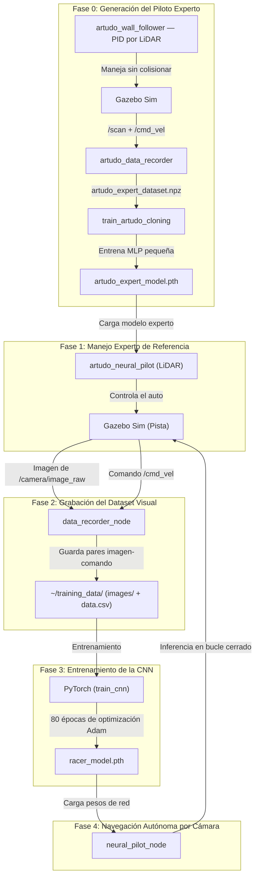

# 🏎️ Robot Vision Sim — Sistema Integral de Navegación Autónoma y Control por Visión

**Plataforma robótica completa de visión computacional y conducción autónoma**, compuesta por dos vertientes sincronizadas:
1. 🚗 **Robot Físico 4WD Smart Car:** Arquitectura embebida de doble microcontrolador (**ESP32 DevKit** para tracción diferencial skid-steering con puente H L298N + **ESP32-CAM OV2640** para streaming MJPEG de baja latencia vía Hotspot directo de Laptop).
2. 🧠 **Simulación e IA en ROS 2 Humble + Gazebo Sim:** Auto autónomo que maneja en circuito cerrado mediante una Red Neuronal Convolucional (CNN estilo **PilotNet**, NVIDIA 2016) entrenada por aprendizaje por imitación end-to-end.
3. 🎮 **Panel HUD Web y Telemetría:** Interfaz web táctil interactiva ([`PaginaWebCarro/`](PaginaWebCarro/)) con visor de cámara en vivo, control manual D-Pad, monitoreo de FPS y render 3D.
4. 🔐 **Seguridad y Parámetros (.env):** Protección estricta de credenciales de red mediante plantillas [`.env.example`](.env.example) y exclusión total de datos privados en Git.

---

## 📑 Índice General

- [🚗 BLOQUE I: Robot Físico 4WD (ESP32 + ESP32-CAM)](#-bloque-i-robot-físico-4wd-esp32--esp32-cam)
  - [Arquitectura de Microcontroladores](#11-arquitectura-de-doble-microcontrolador)
  - [Esquema de Pines y Conexiones Eléctricas](#12-esquema-de-pines-y-conexiones-físicas)
  - [Red de Ultra Baja Latencia (Hotspot de Laptop)](#13-red-de-baja-latencia-zona-con-cobertura-de-laptop)
  - [Endpoints de la API REST y Streaming](#14-endpoints-de-la-api-rest-y-streaming)
  - [Compilación y Flasheo con ESP-IDF](#15-compilación-y-flasheo-con-esp-idf)
- [🧠 BLOQUE II: Simulación y Navegación Autónoma CNN (ROS 2 + Gazebo)](#-bloque-ii-simulación-y-navegación-autónoma-cnn-ros-2--gazebo)
  - [Metodología y Flujo en 4 Fases](#21-metodología-y-flujo-completo)
  - [Arquitectura de la Red CNN (RacerCNN)](#22-arquitectura-de-la-red-cnn-racercnn)
  - [Estructura del Proyecto ROS 2](#23-estructura-del-proyecto)
  - [Guía de Ejecución de la Simulación](#24-guía-de-ejecución-de-la-simulación)
- [🔐 BLOQUE III: Configuración de Variables de Entorno (.env)](#-bloque-iii-configuración-de-variables-de-entorno-env)
- [🛠️ BLOQUE IV: Diagnóstico y Resolución de Problemas Físicos](#-bloque-iv-diagnóstico-y-resolución-de-problemas-físicos)
- [📚 Referencias y Documentación Técnica](#-referencias-y-documentación-técnica)

---

# 🚗 BLOQUE I: Robot Físico 4WD (ESP32 + ESP32-CAM)

### 1.1 Arquitectura de Doble Microcontrolador
Para evitar la contención de recursos entre la captura/codificación JPEG y la generación de señales PWM de alta frecuencia para los motores, la carga de procesamiento se distribuye en dos SoCs ESP32 independientes:

```
┌──────────────────────────────────────────────────────────────────────────────┐
│                            CHASIS FÍSICO 4WD SMART CAR                       │
│                                                                              │
│  ┌────────────────────────┐                   ┌───────────────────────────┐  │
│  │   ESP32-CAM (OV2640)   │                   │    ESP32 DevKit V1        │  │
│  │  - Sensor 2 MP + PSRAM │                   │  - Control Cinemático     │  │
│  │  - MJPEG Streaming    │                   │  - 2x PWM LEDC (Motores)  │  │
│  │  - Core 1 Task         │                   │  - Watchdog Fail-Safe     │  │
│  │  IP: 192.168.137.48    │                   │  - Web HUD Server         │  │
│  └───────────┬────────────┘                   │  IP: 192.168.137.47       │  │
│              │                                └─────────────┬─────────────┘  │
│              │                                              │                │
│              │ Wi-Fi 2.4 GHz Directo                        │ GPIOs L298N    │
│              ▼                                              ▼                │
│    ┌────────────────────────────────────────┐     ┌───────────────────┐      │
│    │  LAPTOP HOTSPOT (192.168.137.1)        │     │  Puente H L298N   │      │
│    │  - ROS 2 Node / Autonomous Pilot       │     │  - 4x Motores DC  │      │
│    │  - Web Remote HUD (Control Táctil)     │     │  - Batería 7.4-12V│      │
│    └────────────────────────────────────────┘     └───────────────────┘      │
└──────────────────────────────────────────────────────────────────────────────┘
```

---

### 1.2 Esquema de Pines y Conexiones Físicas

#### ESP32 DevKit (Control Motriz) ➔ Módulo Puente H L298N
El control de dirección utiliza tracción diferencial tipo oruga (*skid-steering*):

| Función | Pin L298N | Pin ESP32 | Tipo de Señal | Rango / Descripción |
| :--- | :--- | :--- | :--- | :--- |
| **PWM Derecho** | **ENA** | **GPIO 32** | Salida PWM LEDC | Canal 0, 1 kHz, 8 bits (0 - 255) |
| Sentido Der. 1 | **IN1** | **GPIO 33** | Salida Digital | Lógica de giro motor derecho |
| Sentido Der. 2 | **IN2** | **GPIO 22** | Salida Digital | Lógica de giro motor derecho |
| Sentido Izq. 1 | **IN3** | **GPIO 27** | Salida Digital | Lógica de giro motor izquierdo |
| Sentido Izq. 2 | **IN4** | **GPIO 26** | Salida Digital | Lógica de giro motor izquierdo |
| **PWM Izquierdo** | **ENB** | **GPIO 25** | Salida PWM LEDC | Canal 1, 1 kHz, 8 bits (0 - 255) |
| **Tierra Común** | **GND** | **GND** | Masa de Referencia | **Unido al polo (-) de baterías y L298N** |

> [!IMPORTANT]
> **Retiro de Jumpers ENA y ENB:** El módulo L298N incluye de fábrica dos puentes negros en los pines ENA y ENB que fijan la velocidad al 100%. Para habilitar el control variable de aceleración por PWM desde el ESP32, **debes retirar estos dos jumpers** y conectar los pines hembra a GPIO 32 y GPIO 25.
>
> **Masa Común Compartida (Common Ground):** El pin GND del ESP32, GND del ESP32-CAM, GND del L298N y el borne negativo de la fuente de alimentación deben estar unificados en un mismo bus común.

#### ESP32-CAM (Visión por Computadora)
* **Alimentación:** Pin `5V` (alimentado por convertidor DC-DC Buck regulado a 5.0 V estables con capacidad mínima de 2 A).
* **Sensor de Imagen:** OV2640 con soporte PSRAM externa habilitado en `sdkconfig`.
* **Frecuencia XCLK:** 10 MHz (`CAMERA_GRAB_WHEN_EMPTY`) para evitar desincronización de DMA y colas de cuadros obsoletos.
* **LED Flash Frontal:** `GPIO 4`.
* **LED de Estado:** `GPIO 33`.

---

### 1.3 Red de Baja Latencia (Zona con Cobertura de Laptop)

Para eliminar la latencia de routers intermediarios y garantizar transmisión fluida de video, el robot se enlaza a la **Zona con cobertura inalámbrica móvil de Windows (Hotspot)**:

1. **Configuración en Windows:**
   - SSID: `LAPTOP_ROBOT`
   - Contraseña: `12345678` (configurable en `.env`)
   - Banda de red: **2.4 GHz**
   - **Ahorro de energía: DESACTIVADO** (vital para que Windows no suspenda el punto de acceso ante pausas breves de paquetes).
2. **Asignación IP Estática:**
   - **Gateway Laptop:** `192.168.137.1`
   - **ESP32 Motores:** `192.168.137.47`
   - **ESP32-CAM:** `192.168.137.48`

---

### 1.4 Endpoints de la API REST y Streaming

#### ESP32-CAM (`http://192.168.137.48`):
* `GET :81/stream`: Streaming de video continuo MJPEG en puerto dedicado 81.
* `GET /cam.jpg`: Fotograma JPEG estático en tiempo real (consumible por OpenCV / ROS 2).
* `GET /status`: Telemetría del sensor en formato JSON (`fps`, `framesize`, `psram`, `rssi`).
* `GET /flash?val=1`: Enciende (`1`) o apaga (`0`) el reflector LED frontal.

#### ESP32 Motores (`http://192.168.137.47`):
* `GET /`: Interfaz HUD de control remoto táctil D-Pad servida desde la memoria flash del ESP32.
* `GET /fwd`, `/rev`, `/left`, `/right`, `/stop`: Comandos de navegación discreta.
* `GET /drive?l=200&r=200`: Control analógico diferencial continuo (valores de `-255` a `+255`).
* `GET /speed?val=220`: Ajuste dinámico de velocidad base.
* `GET /status`: JSON con estado cinemático, ciclo de trabajo y tiempo de actividad (`uptime_ms`).

> [!NOTE]
> **Watchdog de Seguridad Activo:** El firmware del ESP32 incorpora un temporizador de seguridad de **1500 ms**. Si se interrumpe la comunicación con el nodo de control o navegador, el microcontrolador detiene inmediatamente ambos motores.

---

### 1.5 Compilación y Flasheo con ESP-IDF

Los proyectos se encuentran estructurados con sus archivos `CMakeLists.txt` y `sdkconfig` independientes en la carpeta [`CarroFisico/`](CarroFisico/):

#### Flashear ESP32 de Motores (`COM4`):
```bash
cd CarroFisico/ESP32_Motores
idf.py set-target esp32
idf.py build
idf.py -p COM4 flash monitor
```

#### Flashear ESP32-CAM (`COM5`):
Si se utiliza un módulo adaptador con botones (ESP32-CAM-MB):
1. Mantener presionado `IO0`.
2. Presionar y soltar `RST`.
3. Soltar `IO0` para ingresar a modo descarga.
```bash
cd CarroFisico/ESP32_Camara
idf.py set-target esp32
idf.py build
idf.py -p COM5 flash monitor
```

---

# 🧠 BLOQUE II: Simulación y Navegación Autónoma CNN (ROS 2 + Gazebo)

### 2.1 Metodología y Flujo Completo
El sistema entrena una red neuronal convolucional por **aprendizaje por imitación end-to-end** para mapear directamente los píxeles crudos de la cámara frontal (`/camera/image_raw`) a comandos de dirección y aceleración (`/cmd_vel`), sin reglas manuales de color ni segmentación geométrica.



---

### 2.2 Arquitectura de la Red CNN (`RacerCNN`)
Inspirada en **PilotNet** (NVIDIA 2016), optimizada para inferencia en tiempo real en CPUs de laptop:

| Capa | Tipo de Operación | Dimensión de Salida | Activación |
| :--- | :--- | :--- | :--- |
| **Entrada** | Imagen RGB normalizada | $3 \times 120 \times 160$ | Normalización $[0, 1]$ |
| **Conv1** | `Conv2d(3, 24, kernel=5, stride=2)` | $24 \times 58 \times 78$ | ReLU |
| **Conv2** | `Conv2d(24, 36, kernel=5, stride=2)` | $36 \times 27 \times 37$ | ReLU |
| **Conv3** | `Conv2d(36, 48, kernel=5, stride=2)` | $48 \times 12 \times 17$ | ReLU |
| **Conv4** | `Conv2d(48, 64, kernel=3, stride=1)` | $64 \times 10 \times 15$ | ReLU |
| **Conv5** | `Conv2d(64, 64, kernel=3, stride=1)` | $64 \times 8 \times 13$ | ReLU |
| **Aplanado** | `Flatten` | $6656$ | — |
| **FC1** | `Linear(6656, 100)` | $100$ | ReLU |
| **FC2** | `Linear(100, 50)` | $50$ | ReLU |
| **Salida** | `Linear(50, 2)` | $2$ (`linear_x`, `angular_z`) | Lineal |

---

### 2.3 Estructura del Proyecto

```
robot-vision-sim/
├── CarroFisico/                      # Firmware C ESP-IDF para el robot real
│   ├── ESP32_Motores/                # Proyecto ESP-IDF para control motriz (COM4)
│   ├── ESP32_Camara/                 # Proyecto ESP-IDF para streaming de video (COM5)
│   ├── Esp32.c                       # Código fuente unificado del motor controller
│   ├── Esp32Cam.c                    # Código fuente unificado del streaming OV2640
│   └── README.md                     # Guía técnica específica del hardware físico
├── PaginaWebCarro/                   # Interfaz HUD web con telemetría y render 3D
├── src/sim_vision_test/              # Paquete de ROS 2 Humble (Python)
│   ├── sim_vision_test/
│   │   ├── artudo_wall_follower_node.py # Fase 0: PID por LiDAR
│   │   ├── artudo_data_recorder_node.py # Fase 0: Grabador de datos LiDAR
│   │   ├── train_artudo_cloning.py      # Fase 0: Entrenamiento MLP experto
│   │   ├── artudo_neural_pilot_node.py  # Fase 1: Piloto experto por LiDAR
│   │   ├── data_recorder.py             # Fase 2: Grabador de datos visuales
│   │   ├── train_cnn.py                 # Fase 3: Entrenamiento de RacerCNN
│   │   └── neural_pilot_node.py         # Fase 4: Piloto autónomo CNN por cámara
├── launch/
│   └── robot_camera.launch.py        # Launch file principal de simulación en Gazebo
├── urdf/
│   └── racer_robot.urdf              # Descripción URDF del chasis, sensores y ruedas
├── worlds/                           # Circuitos de simulación en formato SDF
├── .env.example                      # Plantilla de configuración de red y credenciales
├── .gitignore                        # Reglas de exclusión de binarios, caché y .env
└── requirements.txt                  # Dependencias de Python (PyTorch, numpy, pandas)
```

---

### 2.4 Guía de Ejecución de la Simulación

#### 1. Iniciar la Simulación en Gazebo:
```bash
source /opt/ros/humble/setup.bash
source install/setup.bash
ros2 launch launch/robot_camera.launch.py world:=racetrack_decorated headless:=false
```

#### 2. Lanzar el Piloto Autónomo CNN:
En una segunda terminal:
```bash
source /opt/ros/humble/setup.bash
source install/setup.bash
ros2 run sim_vision_test neural_pilot_node
```

---

# 🔐 BLOQUE III: Configuración de Variables de Entorno (.env)

Para evitar exponer contraseñas privadas de Wi-Fi o configuraciones sensibles en repositorios públicos, el proyecto utiliza variables de entorno estandarizadas:

1. Crea tu archivo `.env` local a partir de la plantilla:
   ```bash
   cp .env.example .env
   ```
2. Modifica el contenido de `.env` según tu red:
   ```env
   # Red Wi-Fi Hotspot de la Laptop
   LAPTOP_HOTSPOT_SSID=LAPTOP_ROBOT
   LAPTOP_HOTSPOT_PASS=12345678

   # Red Wi-Fi de Router Local Alternativo
   ROUTER_WIFI_SSID=TU_RED_WIFI
   ROUTER_WIFI_PASS=TU_CONTRASENA

   # Direcciones IP Estáticas
   GATEWAY_IP=192.168.137.1
   ESP32_MOTOR_IP=192.168.137.47
   ESP32_CAM_IP=192.168.137.48
   ```

El archivo `.gitignore` está configurado para **bloquear estrictamente la subida de `.env`**, archivos `.key`, `.bin`, `.elf` y reportes temporales de compilación.

---

# 🛠️ BLOQUE IV: Diagnóstico y Resolución de Problemas Físicos

1. **Uno de los motores no gira o gira sin fuerza:**
   - Verifica que el puente jumper de ENA o ENB en el L298N haya sido retirado si controlas velocidad por PWM.
   - Comprueba con un multímetro que la batería entregue más de 7.4 V bajo carga.
2. **El ESP32-CAM entra en bucle de reset o no se conecta al Hotspot:**
   - En Windows, abre **Configuración ➔ Red e Internet ➔ Zona con cobertura inalámbrica móvil** y desactiva **"Ahorro de energía"**.
   - Conecta un condensador electrolítico de 100 µF a 470 µF entre los pines `5V` y `GND` del ESP32-CAM para absorber los picos de consumo de la radio Wi-Fi.
3. **El puerto serie queda bloqueado en `waiting for download`: **
   - Si usas cable USB con módulo FTDI o ESP32-CAM-MB, pulsa el botón `RST` con `IO0` liberado para que el microcontrolador arranque desde la memoria SPI Flash normal.

---

# 📚 Referencias y Documentación Técnica

* **Informe Técnico Completo de la CNN:** [`informeTecnicoCNN.md`](informeTecnicoCNN.md)
* **Informe de Visión Clásica e Infraestructura:** [`INFORME_VISION.md`](INFORME_VISION.md)
* **Documentación de la Interfaz Web:** [`PaginaWebCarro/README.md`](PaginaWebCarro/README.md)
* Bojarski, M. et al. (2016) — *"End to End Learning for Self-Driving Cars"* (NVIDIA PilotNet).
